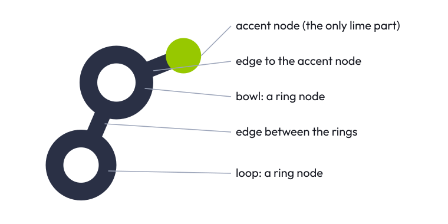
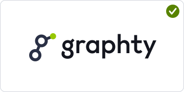
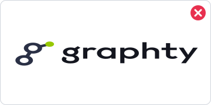
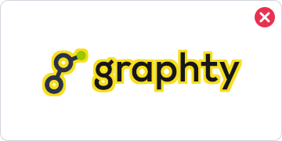
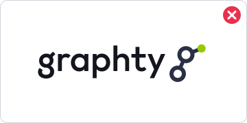
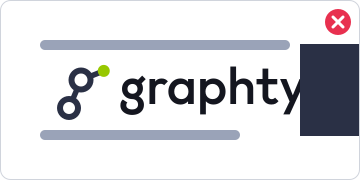
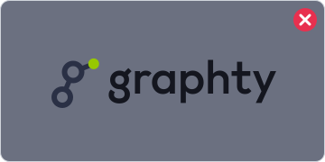
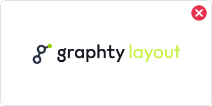

# graphty brand guide

This guide says how to use the graphty logo, colors and type, and which file in this folder to use
for each job. Every logo file here is final artwork: use it as it is, and do not redraw it.

## The brand

graphty is a family of open-source tools for working with graphs on the web: a web component that
draws them, an app built on it, and libraries for layouts, algorithms and graph files. The brand
should feel like the tools: precise, technical and friendly, with one bright signal in an otherwise
calm, dark-ink system. The logo is literally a small graph that spells the name, and the single lime
node is the one thing that lights up, the way a selected node does in a graph tool.

## The logo



The logo has two parts.

- **The mark** is a lowercase "g" built from a graph: two ring nodes (the bowl and the loop) joined
  by an edge, and an edge out to a solid accent node at the top right. The accent node is the only
  part in lime; everything else is ink.
- **The wordmark** is the word "graphty" in Outfit, weight 500, with Outfit's stylistic set 1
  (`ss01`) switched on, which swaps in its alternate "g". In every logo file the letters are
  converted to outlines, so no font is needed to show them. See [Typography](#typography).

### Which circle carries the color

The accent sits on the ear node at the top right, filled solid (no outline), in the lime the kit
first proposed for that node: `#97c800` on white and `#c4f23a` on dark. Everything else is ink. This
is the treatment the design rounds called N1, paired with the green called G-W5. The owner's
instruction was "GW-5 with the dot / circle (top right) using the color as originally suggested":
of the three circle treatments, only N1 puts the color on the top-right dot, and its original
coloring is a plain solid fill on the dot alone. The alternatives (a ring in color, or the dot in
bright lime with an ink outline) are recorded in [explorations.md](explorations.md).

## Lockups

A lockup is a fixed arrangement of the mark and the wordmark. Never assemble one yourself: use the
files.

| Lockup     | Preview                                                                                           | Use it for                                                                                      |
| ---------- | ------------------------------------------------------------------------------------------------- | ----------------------------------------------------------------------------------------------- |
| Horizontal |    | The default: site headers, READMEs, slides, documents, anywhere there is more width than height |
| Stacked    |  | Square or tall spaces: title slides, posters, stickers, profile cards                           |
| Mark       |                           | Small or square places: favicons, avatars, app icons, and anywhere the name is already shown    |
| Wordmark   |             | Rare: only where the mark already appears nearby, such as a footer under a large mark           |

Each lockup comes in four versions:

- **color-on-light**: for white and light backgrounds.
- **color-on-dark**: for black and dark backgrounds (drawn for `#111111`; fine on any background
  darker than the ink `#2a3045`).
- **white**: one color, for dark or colored backgrounds and photos where the color version does not
  hold, and for single-color printing on dark stock.
- **black**: one color, for single-color printing, fax-like reproduction, engraving and embossing.

## Clear space and minimum size

The unit of measure is **n**, the diameter of the accent node: 12/64, about one fifth, of the mark's
height. Keep at least **1 n** of empty space on every side of the mark or any lockup. Nothing (text,
other logos, the edge of a card or screen) may enter it.


| Artwork                   | Smallest on screen      | Smallest in print |
| ------------------------- | ----------------------- | ----------------- |
| Mark                      | 16 px tall              | 5 mm tall         |
| Horizontal lockup         | 20 px tall (80 px wide) | 25 mm wide        |
| Stacked lockup            | 48 px wide              | 15 mm wide        |
| Child-brand lockup        | 24 px tall              | 8 mm tall         |
| Cytoscape co-brand lockup | 24 px tall              | 8 mm tall         |
| Child-brand mark          | 24 px tall              | 8 mm tall         |

Below 24 px a child-brand mark loses the detail that tells it apart; use the plain mark there.

## Color

The palette is lime and ink. Lime is the signal: it marks the one thing that matters on a surface.
Ink carries everything else. Tokens are in [colors/tokens.json](colors/tokens.json) and
[colors/tokens.css](colors/tokens.css), and the palette sheet is
[colors/palette.svg](colors/palette.svg) ([PNG](colors/palette.png)).


Contrast is the WCAG 2.x ratio. Text needs 4.5:1 (3:1 at 24 px and up, or 19 px bold); a graphic
that carries meaning needs 3:1. Logos are exempt from both, which is why the mark may use
`#97c800` on white.

| Color               | Hex       | RGB           | HSL           | On white | On `#111111` |
| ------------------- | --------- | ------------- | ------------- | -------- | ------------ |
| Lime                | `#c4f23a` | 196, 242, 58  | 75, 88%, 59%  | 1.3:1    | 14.49:1      |
| Lime, mark on white | `#97c800` | 151, 200, 0   | 75, 100%, 39% | 1.99:1   | 9.51:1       |
| Lime 500            | `#75a300` | 117, 163, 0   | 77, 100%, 32% | 3:1      | 6.29:1       |
| Lime 700, olive     | `#588300` | 88, 131, 0    | 80, 100%, 26% | 4.51:1   | 4.19:1       |
| Lime 50, tint       | `#f1fbd3` | 241, 251, 211 | 75, 83%, 91%  | 1.08:1   | 17.52:1      |
| Ink                 | `#2a3045` | 42, 48, 69    | 227, 24%, 22% | 13.07:1  | 1.45:1       |
| Text                | `#14161f` | 20, 22, 31    | 229, 22%, 10% | 18.04:1  | 1.05:1       |
| Ink on dark         | `#9aa3b8` | 154, 163, 184 | 222, 17%, 66% | 2.53:1   | 7.47:1       |
| Text on dark        | `#f2f3f7` | 242, 243, 247 | 228, 24%, 96% | 1.11:1   | 17.03:1      |
| Tile on dark        | `#3a4360` | 58, 67, 96    | 226, 25%, 30% | 9.76:1   | 1.93:1       |
| Black               | `#111111` | 17, 17, 17    | 0, 0%, 7%     | 18.88:1  | 1:1          |
| Heart, rose red     | `#e8304f` | 232, 48, 79   | 350, 80%, 55% | 4.23:1   | 4.47:1       |

### Rules for lime

- **On dark, use the bright lime `#c4f23a`** for everything: the mark's node, accent fills, accent
  text (14.49:1 on `#111111`).
- **On white, bright lime is never text and never a thin line.** At 1.3:1 it disappears.
    - The mark's node on white is `#97c800`, and only the mark may use it.
    - Accent text on white (package names, links) is lime 700 `#588300` (4.51:1).
    - Thin graphics on white that must be seen (focus rings, selection outlines, a lone icon) are
      lime 500 `#75a300` (3:1).
    - Lime 50 `#f1fbd3` is a background tint only. Text on it is `#14161f`, not olive (olive is
      4.18:1 on the tint).
- **Labels on a lime fill are dark**, never white: `#14161f` on `#97c800` is 9.08:1 and `#111111`
  on `#c4f23a` is 14.49:1. White on lime fails. The one exception is a lime 700 `#588300` fill,
  which carries white labels (4.51:1).
- **Lime is for one thing at a time.** Use it for the selected, active or primary item, not for
  large areas, decoration or body text.
- **The heart red `#e8304f` belongs to the Cytoscape co-brand only.** It is not an error color and
  not a second accent.

### The app's accent in light and dark themes

The graphty app takes its accent from the brand:

| Role                                 | Light theme                    | Dark theme                     |
| ------------------------------------ | ------------------------------ | ------------------------------ |
| Filled button, active tool           | `#97c800` with `#14161f` label | `#c4f23a` with `#111111` label |
| Accent text, links                   | `#588300`                      | `#c4f23a`                      |
| Focus ring, selection outline, icons | `#75a300`                      | `#c4f23a`                      |
| Selected-row background              | `#f1fbd3`                      | the panel's own raised gray    |

The same roles are in `theme.light` and `theme.dark` of [colors/tokens.json](colors/tokens.json).
Graph drawings use their own data palettes; the accent should not be the only cue for a selection on
a graph whose groups are already colored green.

## Typography

| Use                         | Typeface                                                      | Settings                                                     |
| --------------------------- | ------------------------------------------------------------- | ------------------------------------------------------------ |
| The word "graphty" in logos | Outfit 500                                                    | Stylistic set 1 (`ss01`) on, default kerning, lowercase only |
| Package names in lockups    | Outfit 400                                                    | No stylistic set, lowercase, exactly as the package is named |
| App and documentation text  | Inter (the app's UI font), falling back to the system UI font | As the app's theme sets it                                   |
| Code                        | Roboto Mono, falling back to the system monospace font        |                                                              |

Outfit is by The Outfit Project Authors and is licensed under the SIL Open Font License 1.1, so it
may be used, embedded and shipped freely, but not sold on its own. The logo files do not need it:
the letters are outlines. See [fonts/README.md](fonts/README.md) for where to get it.

Do not set the word "graphty" in another font next to the mark, and do not type the wordmark: use a
logo file. In running text, write the name in lowercase: graphty, graphty-element, graph-io.

## Child brands

Each package has a lockup made of three parts, in this order: its badge (or the plain mark), the
word "graphty" in Outfit 500 in the dark ink, and the package name in Outfit 400 in the accent
(`#588300` on white, `#c4f23a` on dark). The badge is the graphty mark plus one change that says what
the package does.

| Package                          | Badge                                                      | Lockup                                                                                                                                           |
| -------------------------------- | ---------------------------------------------------------- | ------------------------------------------------------------------------------------------------------------------------------------------------ |
| graphty app (`@graphty/graphty`) | the g on a rounded tile, like an app icon                  |                                                     |
| graphty-element                  | the g between angle brackets: a web component              |                         |
| layout                           | the g in a selection box with four lime handles            |                                            |
| algorithms                       | a traced shortest path and a centrality halo on the bowl   |                                |
| graph-io                         | the g stepping out of a document page                      |                                      |
| graph-format                     | the g between square brackets: an array                    |                          |
| graph-samples                    | the g on the front card of a stack of three                |                       |
| webgpu-graph-algorithms          | the g on a chip with pins                                  |          |
| cytoscape-extensions             | the plain mark; its partner sign is the Cytoscape co-brand |  |
| compact-mantine                  | the plain mark                                             |                 |
| visual-review                    | the plain mark                                             |                       |
| remote-logger                    | the plain mark                                             |                       |

The graphty-element lockup reads "graphty element", not "graphty graphty-element", and the app's
reads "graphty app". The four packages without a badge of their own use the plain mark; if one gets
a badge later, it follows the same rule: the unchanged g plus one change, in ink with lime only on
the accent node or on the one detail that carries the meaning.

Rules for child brands:

- Keep the order and spacing of the files. Do not drop "graphty" from a lockup.
- Package names stay exactly as they are spelled on npm, in lowercase, hyphens included.
- Use a child brand only for that package. The graphty mark represents the whole project.

## The Cytoscape co-brand

`@graphty/cytoscape-extensions` brings graphty's layouts and algorithms to Cytoscape.js. Its partner
sign is the graphty mark, a rose-red heart and the Cytoscape.js logo, read as "graphty loves
Cytoscape.js". It comes as a symbol and as a lockup with the package name.


Rules:

- **The Cytoscape.js logo stays exactly as Cytoscape.js publishes it**: its yellow square and black
  drawing, in every version, including the white and black one-color versions of the co-brand. Only
  the graphty mark, the heart and the words change color. Never recolor, crop, outline or redraw
  their logo.
- **The heart is rose red `#e8304f`** in the color versions, and the one-color ink in the one-color
  versions. It is never lime, pink or any other red.
- Keep the spacing of the files: the heart sits midway between the two logos, and the Cytoscape.js
  logo is set slightly smaller than the g so the two look the same size.
- Use the co-brand only for cytoscape-extensions, and only next to a statement that it is a graphty
  project, for example "cytoscape-extensions is made by the graphty project and is not affiliated
  with or endorsed by the Cytoscape Consortium."

### What Cytoscape's own terms say

There is no published logo, brand or trademark policy for Cytoscape or Cytoscape.js. What exists:

- The Cytoscape.js license is MIT
  ([LICENSE](https://github.com/cytoscape/cytoscape.js/blob/master/LICENSE): "Copyright (c)
  2016-2026, The Cytoscape Consortium. Permission is hereby granted, free of charge, to any person
  obtaining a copy of this software and associated documentation files..."). It says nothing about
  logos, names or trademarks, and an MIT license grants no trademark rights. The logo files live in
  the repository's `documentation/img/` folder with no separate license.
- The Cytoscape logos page, https://cytoscape.org/logos.html, offers the logo files and states no
  terms.
- The only written statement found is an answer on the Cytoscape helpdesk list to a question about
  the license of the Cytoscape (desktop) logo
  (https://groups.google.com/g/cytoscape-helpdesk/c/Yx27gJZo9O4): "Go for it! We just ask that you use
  it appropriately, e.g., in reference to the Cytoscape software. And please cite
  https://www.ncbi.nlm.nih.gov/pubmed/14597658." It is informal and about the desktop app's logo,
  not the Cytoscape.js logo.
- Cytoscape.js lists third-party extensions named `cytoscape-<name>` on https://js.cytoscape.org/,
  so naming an extension package after Cytoscape is accepted practice.

**What this means for the co-brand.** Showing the unchanged Cytoscape.js logo to say that
cytoscape-extensions works with Cytoscape.js is reference use, the kind the helpdesk answer allows.
Nothing written requires permission, and nothing written forbids the lockup. But a heart joining two
logos can read as a partnership or an endorsement, and on that the terms are silent. So use the
co-brand only to say that cytoscape-extensions works with Cytoscape.js, keep their logo unmodified,
and always carry the "not affiliated" line beside it. Where that line cannot fit, use the plain
cytoscape-extensions lockup, which shows no Cytoscape artwork.

## Backgrounds and imagery

- The color logos go on white or on black and near-black (`#111111` to the ink `#2a3045`). On any
  other color, a photo or a gradient, use the white or black one-color version, whichever contrasts
  more, and keep the area behind the logo calm.
- On a lime background use the black version; on the ink use the white one or the color-on-dark one.
- Imagery should show real graphs: graphty-element renderings of real data sets, with nodes and edges
  clearly visible. Prefer one highlighted element in lime against ink and gray, echoing the mark.
- Avoid stock photos of people at screens, abstract "network" glows, neon, lens flares and
  three-dimensional chrome. The brand is flat and precise.
- Social images use the dark text color `#14161f` as their background with the color-on-dark
  lockup; see `icons/social/`.

## Misuse

Do:

|  |  |  |  |
| ---------------------------------------- | -------------------------------------- | ------------------------------------------ | -------------------------------------------- |
| Color version on white                   | Color-on-dark version on black         | White version on the ink                   | Black version on the lime tint               |

Do not:

|        |           |  |               |
| ------------------------------------------ | --------------------------------------------- | ------------------------------------------- | ----------------------------------------------- |
| Stretch or squash it                       | Recolor it                                    | Move the lime to another circle             | Add an outline or a glow                        |
|            |              |      |        |
| Add a shadow or other effect               | Rotate or tilt it                             | Rearrange or resize the parts               | Retype the name in another font or case         |
|            |   |      |  |
| Crowd it inside its clear space            | Put it on a mid-tone it cannot stand out from | Put it on a busy image                      | Set small text in bright lime on white          |
|  |                                               |                                             |                                                 |
| Change the heart's color in the co-brand   |                                               |                                             |                                                 |

## Files: which one to use

Every logo comes as SVG (vector, preferred anywhere it is accepted) and as transparent PNG. PNG
names end in their size: `-64.png` is 64 x 64 px, `-800w.png` is 800 px wide.

```
design/brand/
|-- brand-guide.md           this guide
|-- explorations.md          colors and designs considered and set aside
|-- logo/
|   |-- mark/                the g alone; PNG 16 to 1024 px square
|   |-- lockup/horizontal/   mark + wordmark side by side (the default); PNG 200, 400, 800, 1600 px wide
|   |-- lockup/stacked/      mark above wordmark
|   `-- wordmark/            the word alone
|-- child-brands/<package>/
|   |-- mark/                the package badge (packages that have one); PNG 16 to 512 px
|   |-- lockup/              badge + "graphty" + package name
|   `-- wordmark/            "graphty" + package name, no badge
|-- co-brand/cytoscape/
|   |-- symbol/              g, heart, Cytoscape.js logo
|   `-- lockup/              the symbol + "graphty cytoscape-extensions"
|-- icons/
|   |-- favicon/             favicon.ico (16, 32, 48), favicon.svg (adapts to dark mode), PNGs
|   |-- app/                 apple-touch-icon (180), android-chrome 192 and 512, maskable 192 and 512
|   `-- social/              Open Graph 1200 x 630, GitHub social preview 1280 x 640
|-- colors/                  palette sheet, tokens.json, tokens.css
|-- fonts/README.md          where to get Outfit, and its license
|-- guide/                   the diagrams in this guide
`-- explorations/            thumbnails for explorations.md
```

Inside each logo folder the files are grouped as `svg/<version>/` and `png/<version>/`, where the
version is `color-on-light`, `color-on-dark`, `white` or `black`.

| I need...                              | Use                                                                                                             |
| -------------------------------------- | --------------------------------------------------------------------------------------------------------------- |
| The logo on a web page or in a README  | `logo/lockup/horizontal/svg/color-on-light/` (and `color-on-dark/` for dark mode)                               |
| A site favicon                         | `icons/favicon/favicon.svg` plus `icons/favicon/favicon.ico` as the fallback                                    |
| An iOS home-screen icon                | `icons/app/apple-touch-icon.png`                                                                                |
| A web app manifest icon                | `icons/app/android-chrome-192.png`, `-512.png`, and `maskable-192.png`, `-512.png` with `"purpose": "maskable"` |
| A link preview image                   | `icons/social/open-graph-1200x630.png`                                                                          |
| The GitHub repository social preview   | `icons/social/github-social-preview-1280x640.png`                                                               |
| An avatar (GitHub org, npm, chat)      | `logo/mark/png/color-on-light/graphty-mark-color-on-light-512.png`, or the app icon tile                        |
| A package README header                | `child-brands/<package>/lockup/svg/...`                                                                         |
| One-color print, engraving, embroidery | `logo/.../svg/black/` or `svg/white/`                                                                           |
| Colors in code                         | `colors/tokens.css` or `colors/tokens.json`                                                                     |

A favicon set in HTML:

```html
<link rel="icon" href="/favicon.ico" sizes="48x48" />
<link rel="icon" href="/favicon.svg" type="image/svg+xml" />
<link rel="apple-touch-icon" href="/apple-touch-icon.png" />
```

## Ownership

The graphty name and logo belong to the graphty project
([graphty-org](https://github.com/graphty-org)). Questions about using them, and requests for
artwork that is not here, go to the project through an issue on
[graphty-monorepo](https://github.com/graphty-org/graphty-monorepo/issues).
