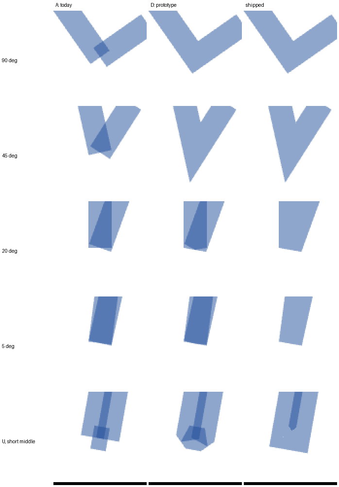
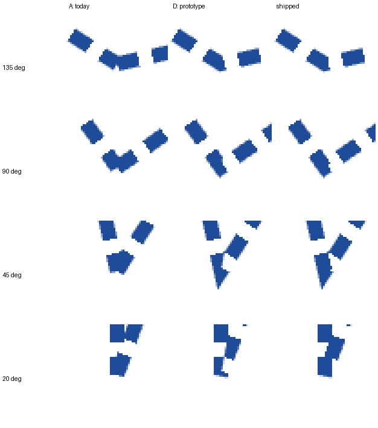
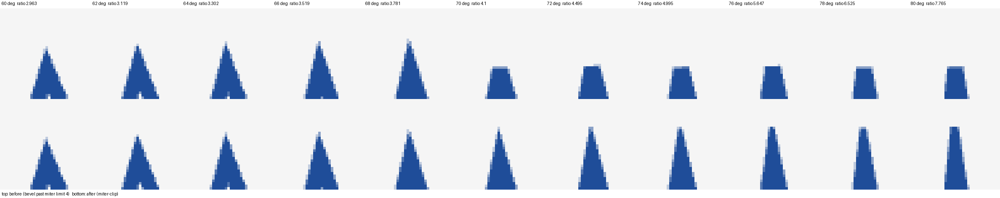

# Sharp corners on bent edges

How graphty-element draws the corner where two straight pieces of one edge meet: an edge drawn
through bends (`edge.bends`, the routes yEd and Cytoscape files carry), and a curve, which is a run
of short straight pieces. This records the problem, every option measured, the one adopted, and
what is left.

Decision (owner, 2026-10-16): build option D, the miter join computed in the vertex shader, with
its three defects fixed. It ships as `graphty-element/src/meshes/edgeJoinShader.ts`. Past the miter
limit a corner is drawn as SVG 2's `miter-clip`, not a bevel (owner, 2026-10-16; see "Past the
miter limit" below).

## The problem

An edge line is a run of straight pieces. Each piece is one slot in an `EdgeLineBatch`
(`graphty-element/src/meshes/EdgeLineBatch.ts`), a batch of instances that draws every line of
one appearance in one draw call. `Edge.placeBent` and `Edge.placeCurve` turn an edge into points,
and `Edge.placeRun` hands the points to the batch, one piece per slot.

Before this change each slot knew only its own two ends:

- In 3D, `CustomLineRenderer`'s vertex shader widened each piece in screen space from its own two
  ends. In 2D, `Simple2DLineRenderer` drew each piece as a flat rectangle placed by a 4x4 matrix
  (`segmentMatrixToRef`). Nothing joined two pieces.
- Outside a bend the two rectangles leave a wedge-shaped notch. It shows on every bend from 170 to
  45 degrees once the line is 3 px wide.
- Inside a bend the two rectangles overlap. On a translucent line the overlap is drawn twice and
  shows as a darker wedge.
- Dashed lines did not bend at all. `PatternedLineMesh` places pattern elements (each dash a small
  box) along a straight line from the edge's start to its end, so a dashed edge with bends was
  drawn straight, and a dashed curve was drawn as a solid curve.

## How the options were compared

One test scene, drawn by every option with Babylon.js 8.56.2 (the version graphty-element uses):
bends with interior angles of 179, 170, 135, 90, 45, 20 and 5 degrees, an exact U-turn, and a U
whose middle piece is 16 px long. Each bend at widths 1, 3, 8 and 24 px, opaque and 50%
translucent, solid and dashed, in 2D (orthographic, one world unit a pixel) and 3D (perspective,
tilted 50 degrees). Captured headless on an RTX 4070 SUPER (ANGLE over Vulkan, 4x MSAA).

The 2D scene is also drawn by the browser's own 2D canvas with `lineJoin = "miter"`,
`miterLimit = 4` and butt caps, the stroke SVG and Canvas define. Each bend is scored against it:
a **hole** is a pixel the canvas fills and the option leaves empty (a notch is a hole), a
**spill** a pixel the option fills and the canvas does not, and an **overlap** a translucent pixel
darker than the line's own tint, that is, drawn twice.

The stress scene is 10,000 or 50,000 edges of 3 pieces each, 2 px wide, on a 1280 x 900 canvas.
Every moving frame rewrites every point (a settling layout) and renders. "Update" is the
JavaScript that rewrites the instance data, "render" one frame with a GPU sync, "still" a frame
with nothing moving. Medians of three runs.

## The options

### A. Separate rectangles (what shipped before)

Each piece is its own rectangle, as described above. No extra cost, and every defect above:
notches from 170 to 45 degrees, a darker overlap on every translucent bend, dashes that restart
on every piece. 1 instance of 4 vertices per piece, 16 floats per instance (a matrix).

### B. Join triangles

A, plus a second thin-instance batch of triangles: two per bend for a miter, one for a bevel past
miter limit 4, each placed by an ordinary matrix, so no shader change. It fills the notch with the
correct miter or bevel shape, but keeps A's overlap and adds its own: a translucent 135 degree bend
shows a dark triangle at the corner. A dashed corner is all dash or all gap. One more draw call
per batch, and 2 triangle instances per bend: the 50,000-edge update took 13.3 ms against A's 7.8.

### C. Round discs

A, plus a 16-segment disc of the line's diameter at every bend. It fills the notch, but the
corner is round rather than sharp, the disc sticks out past sharp corners, and on a translucent
line the whole disc is darker -- the worst blending of any option. 17 more vertices and 48 more
indices per bend, 11.4 ms update at 50,000 edges.

### D. Miter joins in the vertex shader (adopted)

One instance per piece that reads four points: the corner before it, its own start and end, and
the corner after it. The vertex shader moves the piece's end vertices onto the miter points it
shares with its neighbour, and past the miter limit draws its half of the miter clipped flat (see
"Past the miter limit"). Neighbours compute
the shared vertices from the same points with the same arithmetic, so they meet exactly. It works
in screen pixels, so one shader serves 2D and 3D. One draw call, no extra instances, 14 floats per
piece instead of a 16-float matrix, and no trigonometry on the CPU: the 50,000-edge update fell
from 7.8 ms to 4.6 ms.

The prototype was clean from 179 to 45 degrees at every width, opaque and translucent, in 2D and
3D. It had three defects, fixed before shipping (below).

### E. Babylon.js GreasedLine

Babylon's own line mesh (`CreateGreasedLine`), with its built-in dashes. No notch, but every bend
sharper than 90 degrees pinches: at 45 and 20 degrees a 3 px line draws one arm about 1 px wide,
at 20 degrees and below the strip twists into crossing triangles, and dashes come out slanted and
broken at the corner. Its points are rebuilt on the CPU on every move: 36 to 38 ms per frame to
move 50,000 edges, which rules it out for a moving layout.

### F. Lengthened rectangles

A, but each piece lengthened past an interior corner by `(w/2) tan(turn/2)` so the two rectangles'
outer edges meet at the miter tip, with a bevel triangle past the limit. No shader change. The
miter shape is right at 135 and 170 degrees, but the overlap is larger than A's, and between 90
and about 29 degrees the lengthened pieces cross and poke out past each other: geometry, not a
bug. 17.3 ms update at 50,000 edges.

### Also considered

- **A stencil or depth trick** to keep the overlap from blending twice. It needs a second pass or
  per-edge depth bookkeeping, and does nothing for the notch or for dashes.
- **Joining on the CPU into one triangle strip per edge** (the classic polyline triangulation).
  It is what E does, and E's update cost is what a per-move CPU rebuild costs.

### Results

| Option                 | Notch outside   | Translucent overlap     | Dashes at a bend            | Draw calls | Update ms, 50k edges (2D / 3D) | Still frame ms, 50k (2D / 3D) |
| ---------------------- | --------------- | ----------------------- | --------------------------- | ---------: | -----------------------------: | ----------------------------: |
| A today                | yes             | yes                     | restart per piece           |          1 |                      7.8 / 7.4 |                   0.88 / 0.35 |
| B join triangles       | filled          | yes, plus the triangles | solid or gap as a block     |          2 |                       13.3 / - |                      1.16 / - |
| C round discs          | filled, round   | the whole disc          | a round blob                |          2 |                    11.4 / 10.9 |                   1.24 / 0.71 |
| D prototype            | filled          | none from 179 to 45 deg | a sliver inside sharp bends |          1 |                      4.6 / 4.6 |                   0.87 / 0.38 |
| E GreasedLine          | filled, pinched | mostly none             | slanted, broken             |          1 |                    37.7 / 36.2 |                   0.89 / 0.38 |
| F lengthened           | filled          | larger than A           | like B                      |          2 |                       17.3 / - |                      0.99 / - |
| **Shipped (D, fixed)** | filled          | none (see limits)       | continuous                  |          1 |                  **4.6 / 4.4** |               **0.87 / 0.52** |
| Shipped, miter-clip    | filled, clipped | none (see limits)       | continuous                  |          1 |                      4.9 / 4.8 |                   0.89 / 0.62 |

Render times under about 1 ms move by up to 2x between runs; the update column is stable to about
10%. Against the canvas reference, over every bend of the 2D scene: the prototype D had 5,189
overlap pixels and 242 hole pixels solid, and 720 hole pixels dashed (the sliver); the shipped
shader has 407 overlap pixels (all but one in the short-middle U, see limits) and no hole or spill,
solid or dashed, apart from 8 dashed pixels in the short-middle U.

## Why D

It is the only option that fixes the notch and the translucent overlap together. It keeps one
draw call per appearance, adds no instances, and is cheaper than what it replaces on the CPU,
because a piece is fourteen floats copied rather than a matrix composed with trigonometry. It is
the approach the established GPU line renderers take: deck.gl's path layer, regl-gpu-lines, pygfx
and Mapbox and MapLibre's line layers all give each segment its neighbours and build the join on
the GPU or in the vertex data.

## The three fixes

The prototype D decided per corner whether to miter, and when the inner miter point would reach
further back than half of either piece it fell back to plain square ends. That fallback caused all
three defects.

1. **Bends too sharp to miter (5 degrees, the U-turn, 20 degrees at 24 px).** The square-ended
   fallback overlapped, so translucent lines went dark again. Now every piece always draws its full
   rectangle with square ends, plus the outer half of the join -- the miter up to the limit,
   clipped past it -- and the overlap on the inside is resolved per fragment. The line through the
   corner along the bisector splits the overlap: each piece keeps the fragments on its own side,
   and gives up a fragment on its neighbour's side only when the neighbour's rectangle covers it.
   Both pieces compute that line from the same three points with the same arithmetic, so the two
   tests are exact complements: every pixel of the union is drawn exactly once, at any angle,
   including a U-turn.
2. **Pieces shorter than the line is wide (the short-middle U drew a five-sided blob).** With no
   inner miter point there is nothing to reach past a short piece, so the U draws its true mitered
   outline. The outer miter is also limited: it is clipped where it would reach further past the
   corner than the shorter of its two pieces is long.
3. **Dashes at a bend (a white sliver inside sharp bends).** Each piece measured dash distance
   along itself, so on each side of the corner's bisector the inside of the bend got a different
   distance. Now a fragment in the overlap is drawn when either piece's dash covers it, measured
   along that piece -- the same pixels as dashing the centre line and then stroking every dash,
   which is what SVG and Canvas draw. The outer join takes the distance at the corner.

The browser test `graphty-element/test/browser/edge-corner-joins.test.ts` draws the scene above and
checks every bend against the canvas reference, for all three.

### Who draws a pixel where pieces overlap

The split at the bisector was later restated as a rule that also covers pieces that are not
neighbours and the 3D camera's perspective (issues #3096 and #3114):

- **Each piece reads five pieces:** itself, its neighbours and the pieces two away (a slot carries
  the corners two back and two ahead, 20 floats). A piece shorter than the line is wide lets the
  pieces either side of it overlap each other, along their whole length when they run side by side.
- **Of the pieces whose shape covers a pixel's centre, the one whose centre line is nearest draws
  it, the earlier on a tie.** A shape is the piece and the joins at its corners. Between two
  neighbours the nearest-line split is the bisector, so this is the old rule there; past a short
  piece it settles the overlap of the pieces either side, and where three pieces overlap exactly
  one draws, because distance orders them. Inside a join at a piece's own corner the two pieces'
  triangles already split it along that same line, so there the rasterizer decides.
- **Every piece tests the same point with the same numbers.** The fragment's position interpolated
  from a varying is off by a few hundredths of a pixel, differently in each piece's triangles, so
  the shader snaps it to the centre of the pixel being drawn (it reads the viewport's size in
  pixels as each draw binds). Two pieces compare a pair of distances from the same point by the
  same arithmetic, so their tests are exact complements; distances within 0.001 px tie, so two
  pieces along one line (a U-turn) split by order rather than by rounding.
- **Under perspective a piece is a trapezoid,** wider at its nearer end, and a neighbour is tested
  at its width at both ends, as its triangles draw it.
- **Coverage is tested 0.05 px inside the edges first,** where it always agrees with what the
  rasterizer drew (it snaps corners to a sub-pixel grid). Only a pixel no shape covers by that much
  -- where two edges cross, or the line's anti-aliased edge -- is tested at the edges themselves.

`graphty-element/test/browser/edge-corner-joins-3d.test.ts` draws each piece of a bent edge on its
own, from the slot the batch wrote for it, at bends from 150 to 35 degrees and U-turns with a short
middle, as the camera turns from straight on to 80 degrees: no pixel is drawn by two pieces, and
together they cover every pixel the pieces cover drawn as plain lines.

## Past the miter limit

Every miter join needs a rule for a corner so sharp that its point would reach far beyond the
line: SVG and Canvas stop at a miter limit, the point's length over half the line's width, of 4 by
default. The shader first did what `stroke-linejoin: miter` does past the limit, and drew a bevel.

That is right for a fixed drawing, but in 3D the angle a reader sees is the angle on screen, which
changes as the camera turns. In the 3D bends story (`Styles/Edge`, `ThreeDBends`), turning the
camera sideways foreshortens the 60 degree bend until its screen angle is sharper than the limit
allows. Measured by turning the camera in steps and computing each step's screen-space join as the
shader does, then measuring how far the drawn point reaches along the miter direction:

| Camera turned | Screen angle | Miter length / half-width | Drawn point (bevel past limit) | Drawn point (miter-clip) |
| ------------: | -----------: | ------------------------: | -----------------------------: | -----------------------: |
|        66 deg |     33.0 deg |                      3.52 |                        11.3 px |                  11.3 px |
|        68 deg |     30.7 deg |                      3.78 |                        11.3 px |                  11.3 px |
|        70 deg |     28.2 deg |                      4.10 |                     **1.8 px** |                  13.8 px |
|        72 deg |     25.7 deg |                      4.50 |                         1.0 px |                  13.0 px |
|        80 deg |     14.8 deg |                      7.77 |                         1.0 px |                  13.0 px |

The point vanished between 68 and 70 degrees, exactly where the ratio crossed 4 (the half-width
there is 3.1 px, so a clipped point reaches 4 x 3.1 = 12.4 px plus anti-aliasing).

SVG 2 defines `stroke-linejoin: miter-clip` for this: "the same as miter but if the
stroke-miterlimit is exceeded, the miter is clipped at a distance equal to half the
stroke-miterlimit value multiplied by the stroke width from the intersection of the path
segments", by a line perpendicular to the bisector (https://www.w3.org/TR/SVG2/painting.html#LineJoin
and the editor's draft https://svgwg.org/svg2-draft/painting.html). At the limit the clip line
passes through the miter's tip, so the point never jumps: it grows up to the limit and then stays
4 half-widths long, flat-topped, however sharp the bend gets. A U-turn is the limit of that: the
line runs on 4 half-widths past the corner, or as far as the shorter piece, whichever is less.

The shader keeps one draw call and one instance per piece: each piece's half of the join is two
triangles, centre to side to where the side meets the clip line, and centre to there to the clip
line's point on the bisector. Unclipped, both join vertices sit on the miter tip and the second
triangle is empty. The template grows from 10 to 14 vertices and from 6 to 8 triangles. The extent
is computed along the line, `(limit - cos h) * hw / sin h` past the corner where `h` is half the
turn, which stays exact at a U-turn. The same rule replaces the short-piece bevel: the join is
clipped where it would reach past the shorter piece, so that limit has no jump either.

The cost, measured on the stress scene (3 pieces an edge, every point rewritten each moving frame)
with the shader before and after the change, in one session. GPU figures are medians of three runs
on the RTX 4070 SUPER; SwiftShader figures are one run each, since one frame there takes 0.2 to 1.1
seconds:

| Scene                   | Update ms, before / after | Moving frame ms, before / after | Still frame ms, before / after |
| ----------------------- | ------------------------: | ------------------------------: | -----------------------------: |
| GPU, 10,000, 2D         |               0.80 / 0.80 |                     0.60 / 0.60 |                    0.26 / 0.26 |
| GPU, 10,000, 3D         |               0.80 / 0.80 |                     0.60 / 0.50 |                    0.19 / 0.22 |
| GPU, 50,000, 2D         |               4.80 / 4.90 |                     2.20 / 2.20 |                    0.90 / 0.89 |
| GPU, 50,000, 3D         |               4.80 / 4.80 |                     1.60 / 1.80 |                    0.47 / 0.62 |
| SwiftShader, 10,000, 2D |               1.30 / 1.10 |                       225 / 179 |                      223 / 211 |
| SwiftShader, 10,000, 3D |               1.20 / 1.10 |                       224 / 216 |                      223 / 209 |
| SwiftShader, 50,000, 2D |               4.80 / 4.60 |                   1,083 / 1,076 |                  1,128 / 1,087 |
| SwiftShader, 50,000, 3D |               5.00 / 6.20 |                   1,074 / 1,136 |                  1,130 / 1,061 |

The update is the same JavaScript, so it does not change; the frame times move within the run to
run spread noted under "Results" (render times under about 1 ms move by up to 2x). Four more
vertices a piece cost nothing measurable on either renderer, which matches the SwiftShader finding:
its cost follows the instance count, not the vertices.

No browser draws `miter-clip` in a 2D canvas (Canvas has only `miter`, `round` and `bevel`), so the
corner test fills the clipped shape from its geometry over the canvas stroke at corners past the
limit, and a sweep of bends from 40 to 18 degrees, half a degree apart at 3, 8 and 24 px, checks
that the point moves by no more than 1.5 px plus a tenth of a half-width per step (it jumped by
about 3 half-widths before) and reaches as far as the reference's.

## Widths in 2D and 3D

The shader takes the width two ways (`WORLD_WIDTH`):

- **3D solid lines** keep their screen-space width exactly as before: `width * 0.25 / w` pixels
  either side of the line, which tapers with distance.
- **2D lines take their width in world units**, so a 2D line still zooms with the graph the way
  the nodes do, as the flat rectangles did. The shader converts it to pixels at each vertex from
  the projection.

A constant on-screen width for 2D lines (pixels whatever the zoom) is a consumer's choice, not the
element's. If it is wanted it comes as a new option whose default keeps today's world-space
width; nothing about the default changes.

Both keep the sub-pixel rule the renderers had: a line thinner than one pixel is drawn one pixel
wide with its opacity scaled by its width, as a canvas draws a hairline.

## Dashed and patterned lines

- **Dash and dot, on a bent edge or a curve**, are drawn by the same joined line, the pattern in
  its fragment shader, measured along the whole edge: dash and dot lengths, widths and the
  even spacing (first element at the start, last at the end, `line.patternCount` honoured) are the
  pattern elements' own, so a bent dashed edge matches a straight one beside it. A dot is round.
  A dashed curve used to be drawn solid; it is dashed now.
- **Dash and dot on a straight edge** are still drawn by `PatternedLineMesh`, unchanged. Moving
  them onto the shader would change how every straight dashed edge looks, and the decision was
  that edges without bends do not change. Moving them later is one routing condition in
  `EdgeMesh.drawsAsPattern`.
- **Star, box, diamond, dash-dot, sinewave and zigzag** are pattern elements placed along a
  straight line, so on a bent edge they are still drawn straight from end to end. Placing them by
  distance along the bent path is follow-up work (tracked as an issue).

## The SwiftShader finding

On SwiftShader (Chromium's software renderer, which CI's browser tests use), the instanced
variants ran 5 to 13 times slower per frame than one mesh holding the same triangles. Measured with
an eighth variant, H: A's rectangles expanded on the CPU into one plain, non-instanced mesh.

| 2D, still frame on SwiftShader        | 2,500 edges (7,500 pieces) | 10,000 edges (30,000 pieces) |
| ------------------------------------- | -------------------------: | ---------------------------: |
| A instanced rectangles                |                    46.5 ms |                     173.9 ms |
| Shipped joined line (instanced)       |                    47.8 ms |                     220.8 ms |
| H the same rectangles, one plain mesh |                     8.9 ms |                      28.6 ms |
| E GreasedLine, one plain mesh         |                    11.1 ms |                      35.6 ms |

The cost follows the instance count, not the triangles: about 6 us per instance for A and 7 us for
the joined line, the same at both sizes, while H draws the same triangles six times faster. So
SwiftShader pays a fixed cost per instance of an instanced draw; the vertex shader's length barely
matters. A real GPU shows nothing of the kind (0.87 ms for 150,000 instanced pieces). It matters
only for software rendering -- CI, and a reader with no GPU -- and is the same for the batch before
and after this change.

The cause is SwiftShader's Vulkan driver, which runs an instanced draw as one draw per instance
(`CmdDrawBase::draw` loops over the instances), so each piece pays a draw's setup. Fewer attributes
do not help: the widened line (eleven attributes a piece) costs the same as the plain one (six).
So since issue #3095 `EdgeLineBatch` draws a joined line as one plain mesh when the WebGL renderer
is a software one (`drawsExpandedLines`: SwiftShader, llvmpipe, Microsoft's Basic Render Driver):
the template repeated once per slot, each slot's floats repeated into its fourteen vertices, read
by the same shader, so the picture is the same; `test/edge-line-batch.test.ts` holds every vertex's
inputs against the instance it stands for. A GPU keeps the instances, where expanding is slower.

| 10,000 three-piece edges, one batch | instanced still | instanced moving | expanded still | expanded moving |
| ----------------------------------- | --------------: | ---------------: | -------------: | --------------: |
| SwiftShader                         |          171 ms |           163 ms |        14.9 ms |         27.4 ms |
| NVIDIA RTX 4070 SUPER               |          1.5 ms |           3.3 ms |        10.9 ms |         21.5 ms |

`test/browser/instanced-lines.bench.test.ts` measures it (`--project=browser-bench`; set
`GRAPHTY_BROWSER_GPU=nvidia` for the card).

## Known limits

- **Pieces three apart can overlap.** A piece reads the pieces two away, not three, so two pieces
  in a row shorter than the line is wide can let the pieces either side of them overlap, and a
  translucent line shows that overlap darker.
- **A dash on a piece two away is placed at its neighbour's scale.** Under perspective the dash
  there can be off by a fraction of a pixel; in 2D the scale is the same for every piece.

## Prior art

- Matt DesLauriers, "Drawing Lines is Hard": https://mattdesl.svbtle.com/drawing-lines-is-hard
- Rye Terrell, "Instanced Line Rendering", parts 1 and 2:
  https://wwwtyro.net/2019/11/18/instanced-lines.html and
  https://wwwtyro.net/2021/10/01/instanced-lines-part-2.html
- regl-gpu-lines (Ricky Reusser), instanced lines with joins, caps and per-vertex attributes:
  https://github.com/rreusser/regl-gpu-lines
- three.js fat lines (`Line2`, `LineMaterial`), instanced screen-space segments without joins:
  https://threejs.org/examples/#webgl_lines_fat
- Mapbox, "Drawing Antialiased Lines with OpenGL":
  https://blog.mapbox.com/drawing-antialiased-lines-with-opengl-8766f34192dc, and MapLibre's line
  tessellation: https://github.com/maplibre/maplibre-gl-js/blob/main/src/data/bucket/line_bucket.ts
- deck.gl `PathLayer` (miter limit, rounded joints): https://deck.gl/docs/api-reference/layers/path-layer
- Babylon.js GreasedLine: https://doc.babylonjs.com/features/featuresDeepDive/mesh/creation/param/greased_line
- pygfx line rendering, including the broken join and dash continuity through a join (Almar
  Klein): https://almarklein.org/line_rendering.html
- Nicolas P. Rougier, "Shader-Based Antialiased, Dashed, Stroked Polylines", Journal of Computer
  Graphics Techniques 2(2), 2013: https://jcgt.org/published/0002/02/08/
- SVG 2, `stroke-linejoin` and `stroke-miterlimit`:
  https://www.w3.org/TR/SVG2/painting.html#LineJoin

## Regenerating the measurements

The prototype and its scripts are in `prototype/`: `proto.js` draws the test or stress scene with
any option (`proto.html?variant=A|B|C|D|E|F|G|H&mode=2d|3d&dash=0|1&stress=0|10000|50000`; G is
the shipped shader, read from graphty-element's source, and `ref=1` adds the canvas reference).
Serve the folder with Vite through servherd (`vite.config.js` reads `PORT` and `HOST`), then:

- `node check.mjs <url> <variant> 2d|3d 0|1` captures one scene into `shots/` with its reference,
  which is the canvas's `miter` stroke, so G's clipped corners at 20 degrees and sharper score as
  spill there (the corner test in graphty-element draws the `miter-clip` reference);
  and `python3 metrics.py <variant>-2d-solid` (or `-dash`) scores every bend.
- `node perf.mjs <url> gpu|swiftshader <edges> <variant>-<mode> ...` measures the stress scene.

They need Playwright's Chromium with a GPU it can reach through ANGLE on Vulkan; `EGL_LIB_DIR`
names the driver's libEGL directory when Chromium does not find it.
